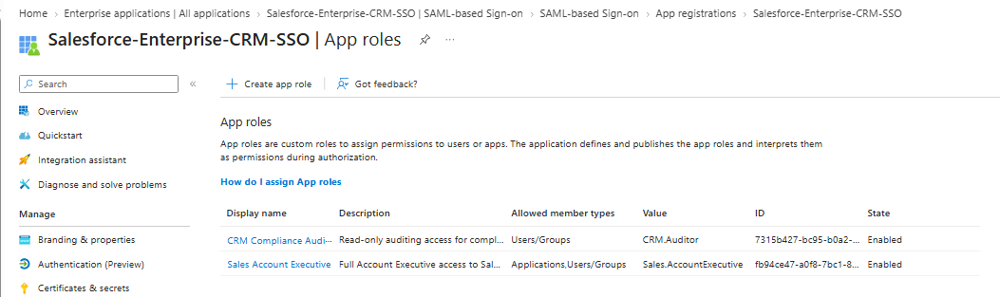
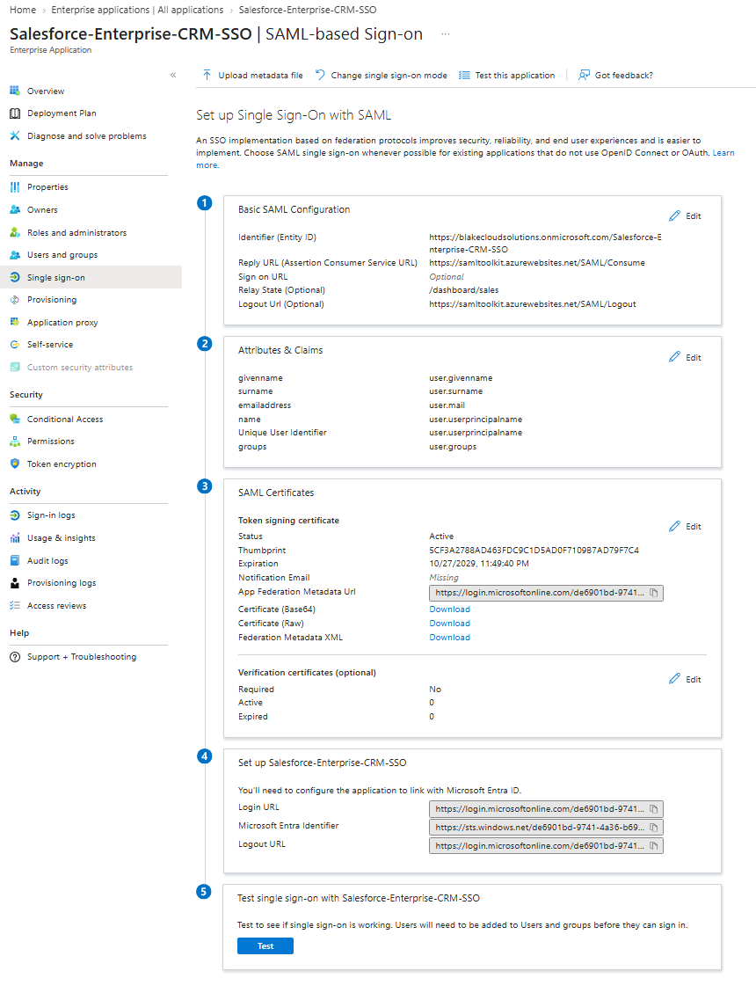
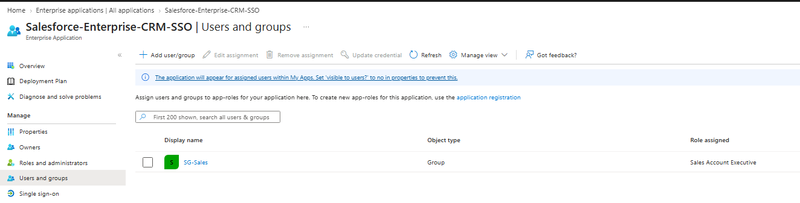
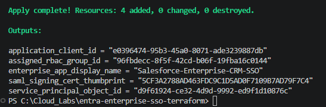

# Enterprise SSO & SaaS Application Integration (SAML 2.0 / OIDC via Terraform)

When departments spin up third-party SaaS applications (like Salesforce, ServiceNow, or HR portals) without integrating them into a central Identity Provider (IdP), two problems show up fast:
* **Shadow IT & Orphaned Accounts:** Users maintain separate local passwords for every app, and when someone leaves the company, their third-party SaaS login often stays active even after their Active Directory account is disabled.
* **Over-Permissioned Access:** Manually clicking through the Entra ID gallery to set up Single Sign-On (SSO) often leaves the application open to *all* tenant users by default instead of scoping access strictly to the right department security groups.

In this lab, I automated the end-to-end onboarding of an enterprise SaaS application (**Salesforce Enterprise CRM**) in Microsoft Entra ID using Terraform. It links directly to the on-premises Active Directory security groups (`SG-Sales` and `SG-HR`) synced in my earlier hybrid labs—so when a user moves into `SG-Sales` on the Domain Controller, they automatically inherit SSO access and the right CRM role claim in the cloud.

---

## Architecture & Tech Stack
* **Identity Provider (IdP):** Microsoft Entra ID (federated via SAML 2.0 and OpenID Connect)
* **Infrastructure as Code:** Terraform (`hashicorp/azuread`, `hashicorp/random`, `hashicorp/time`)
* **Hybrid RBAC Source:** On-Premises Windows Server Active Directory Security Groups (`SG-Sales`) synced via Entra Connect
* **Security Controls:** Strict App Role Assignment (`app_role_assignment_required = true`), custom SAML/OIDC attribute claims, and automated 3-year SAML Token Signing Certificate management

---

## How the Terraform Deployment Works

### 1. Declarative App Registration & Custom App Roles (`main.tf`)
In Entra ID, an application consists of two separate objects: the **Application Registration** (the global blueprint where roles and token claims are defined) and the **Service Principal / Enterprise Application** (the local tenant instance where SAML SSO and user/group access are enforced).

First, Terraform provisions the Application Registration and defines two custom RBAC App Roles (`Sales.AccountExecutive` and `CRM.Auditor`) in the app manifest using deterministic UUIDs:

---

### 2. SAML 2.0 Federation, Claims & Signing Certificate
Next, Terraform provisions the Enterprise Application Service Principal in SAML SSO mode (`preferred_single_sign_on_mode = "saml"`), configures the Entity ID, Assertion Consumer Service (ACS) Reply URL, and Relay State (`/dashboard/sales`), maps the user identity and `user.groups` claims, and generates an active 3-year SAML Token Signing Certificate:

---

### 3. Zero-Trust RBAC Enforcement (`SG-Sales` Group Mapping)
By default, new Enterprise Applications in Entra ID allow any user in the directory to authenticate if they have the URL. To lock this down, I enforced `app_role_assignment_required = true` on the Service Principal and bound our synced `SG-Sales` group directly to the **Sales Account Executive** role (`azuread_app_role_assignment`). Anyone outside `SG-Sales` (such as `SG-HR`) is immediately blocked at sign-in with `AADSTS50105`.

**Terraform Apply Output:**

---

## Troubleshooting & Lessons Learned

### Resolving Entra ID's `HostNameNotOnVerifiedDomain` SAML Entity ID Block (`400 Bad Request`)
* **What happened:** On my first `terraform apply`, creating the `azuread_application` resource failed immediately with a `400 Bad Request` and the OData error: `HostNameNotOnVerifiedDomain: Values of identifierUris property must use a verified domain of the organization or its subdomain: 'https://samltoolkit.azurewebsites.net/BlakeCloudCRM'`.
* **Root cause:** To prevent multi-tenant app spoofing and phishing attacks, Microsoft hardened the Graph API so that programmatic App Registrations cannot use arbitrary external domains inside the `identifier_uris` (App ID URI / SAML Entity ID) property. While the ACS Reply URL (`redirect_uris`) can point to an external SaaS consumer endpoint (`https://samltoolkit.azurewebsites.net/SAML/Consume`), the Identifier URI must match a verified domain in the Entra tenant or use the `api://` scheme.
* **The fix:** I refactored `identifier_uris` in `main.tf` to use my verified tenant domain (`https://blakecloudsolutions.onmicrosoft.com/Salesforce-Enterprise-CRM-SSO`) while keeping the Reply and Logout URLs pointed at the external SAML consumer endpoints. The subsequent `terraform apply` completed cleanly in 6 seconds.

---

## How I Would Improve This Next Time (Production Roadmap)

1. **Automate Certificate Rotation Alerts via Logic Apps / Key Vault:** While Terraform provisions the 3-year SAML Token Signing Certificate (`azuread_service_principal_token_signing_certificate`), expired SAML certs are one of the most common causes of production SSO outages. In production, I would configure automated expiration alerts 60 days out or manage the signing certificate lifecycle through Azure Key Vault.
2. **Add SCIM 2.0 Automated User Provisioning:** SAML 2.0 handles authentication, but many SaaS apps still need the user profile created ahead of time. Wiring up Entra ID SCIM provisioning (`azuread_synchronization_job`) alongside SAML SSO would automatically provision and deprovision user accounts inside the target SaaS app whenever `SG-Sales` membership changes.
3. **Reusable Terraform Modules for Multi-App Onboarding:** Instead of writing standalone resource blocks for one application, I would wrap this pattern into a reusable Terraform module (`modules/enterprise-saml-app`) fed by a `YAML` or `tfvars` map so onboarding 20+ SaaS apps only requires adding a few lines of configuration per app.
